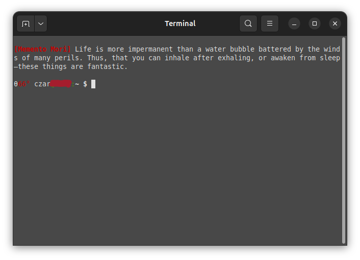

# memento-cli ⏳

**High-frequency wisdom injection for terminal-based workflows.**

Inspired by the *LamRim* (Stages of the Path to Enlightenment) and the traditions of *Memento Mori* and *Vanitas*, `memento-cli` transforms your terminal from a mere utility into an active site of awareness.



## 🧠 The Philosophy
Most CLI tools focus on **Latency** (speed). This tool focuses on **Presence**. 

It injects "Interrupt Signals"—short, high-density quotes—into your shell startup. These are categorized by their systemic function:
- **Urgency Protocol:** To combat procrastination and the illusion of infinite time.
- **Vanitas Protocol:** To reduce attachment to digital/material clutter.
- **Decay Protocol:** To ground the user in the biological reality of impermanence.

## 🚀 One-Line Installation
If you trust the source, run this command:
```bash
curl -sSL https://raw.githubusercontent.com/czar/memento-cli/main/install.sh | bash
```
## 🛠 Installation (Manual)
1. Clone the repo: `git clone https://github.com/czar/memento-cli.git`
2. Enter the directory: `cd memento-cli`
3. Run the installer: `./install.sh`

## 📜 Requirements
- A Unix-based terminal (Linux, macOS).
- Bash or ZSH.
- `sed` and `shuf` (standard on most distros).

## ⚖️ License
Distributed under the MIT License. See `LICENSE` for more information.

```MIT License

Copyright (c) 2026 Czar_Automata (czar)


Permission is hereby granted, free of charge, to any person obtaining a copy
of this software and associated documentation files (the "Software"), to deal
in the Software without restriction, including without limitation the rights
to use, copy, modify, merge, publish, distribute, sublicense, and/or sell
copies of the Software, and to permit persons to whom the Software is
furnished to do so, subject to the following conditions:

The above copyright notice and this permission notice shall be included in all
copies or substantial portions of the Software.

THE SOFTWARE IS PROVIDED "AS IS", WITHOUT WARRANTY OF ANY KIND, EXPRESS OR
IMPLIED, INCLUDING BUT NOT LIMITED TO THE WARRANTIES OF MERCHANTABILITY,
FITNESS FOR A PARTICULAR PURPOSE AND NONINFRINGEMENT. IN NO EVENT SHALL THE
AUTHORS OR COPYRIGHT HOLDERS BE LIABLE FOR ANY CLAIM, DAMAGES OR OTHER
LIABILITY, WHETHER IN AN ACTION OF CONTRACT, TORT OR OTHERWISE, ARISING FROM,
OUT OF OR IN CONNECTION WITH THE SOFTWARE OR THE USE OR OTHER DEALINGS IN THE
SOFTWARE.

