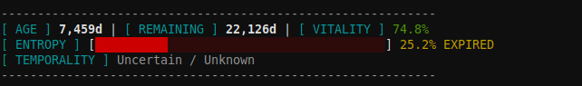
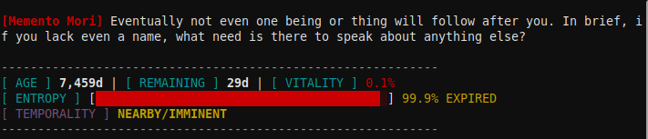
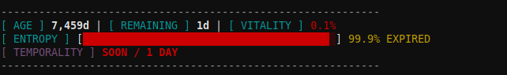
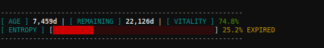

# Memento Mori CLI & Mori-Kernel ⏳  

[](https://opensource.org/licenses/MIT)
[]()

**High-frequency wisdom injection for terminal-based workflows.**

**Memento Mori CLI** is a terminal-based integration designed to bridge philosophical mindfulness with biological reality. It combines the "Mori-Kernel" (a life-statistics engine) with high-frequency wisdom injection from Tsongkhapa's *LamRim* (Stages of the Path to Enlightenment).

By integrating directly into your shell environment, it serves as a constant, subtle reminder of impermanence—encouraging mindfulness and urgency in every terminal session.

Inspired by the *LamRim* (Stages of the Path to Enlightenment) and the traditions of *Memento Mori* and *Vanitas*, `memento-cli` transforms your terminal from a mere utility into an active site of awareness.







### 💀 Mori-Kernel Integration
The `mementomori` binary acts as a temporal engine. Upon shell startup, it calculates and displays vital life statistics based on your biological parameters, providing a "reality check" on the time remaining.

### 📜 LamRim Wisdom Injection
Automated injection of randomized philosophical quotes from the *LamRim* text. Quotes are categorized into three layers of mindfulness:
- **The Urgency Protocol (Temporal Compression):** Reminders to act now before death arrives suddenly.
- **The Vanitas Protocol (Attachment Filter):** Reflections on letting go of worldly attachments.
- **The Decay Protocol (Biological Reality):** Observations on the impermanence of the physical form.

### 🛠️ Seamless Shell Integration
The installer automatically detects your shell (`bash` or `zsh`) and injects the logic into your configuration files (`.bashrc` or `.zshrc`), ensuring a zero-touch experience after installation.


## 🚀 Installation

**Prerequisites:**
- A Linux/Unix-based environment.
- `bash` or `zsh` installed.
- The `mementomori` binary located in the same directory as `install.sh`.

**Steps:**

1. **Make the installer executable:**
   ```bash
   chmod +x install.sh
   ```

2. **Run the integration setup:**
   ```bash
   ./install.sh
   ```

3. **Follow the interactive prompts:**
   - Enter your birthdate (`YYYY-MM-DD`).
   - Specify sex (optional).
   - Set expected lifetime (defaults to 81 years).

4. **Finalize:**
   Restart your terminal or run:
   ```bash
   source ~/.bashrc  # or source ~/.zshrc
   ```
## 📖 Usage

### Automated Mode
Once installed, the tool runs automatically every time you open a new terminal window. You will see:
1. A randomized **LamRim Wisdom** quote in red text.
2. Your **Mori-Kernel Stats** (Life countdown/statistics).

### Manual Execution
You can manually trigger the kernel stats at any time by calling the binary directly:

```bash
# Basic usage with birthdate and sex
mementomori -b 1990-01-01 -s m -v

# Flags:
# -b <YYYY-MM-DD>  Set Birthdate
# -s <m|f>         Set Sex (default: m)
# -v               Verbose/Stats mode
```

---

## 🏗️ Technical Architecture

### The Wisdom Store (`~/.lamrim_death.txt`)
The installer creates a structured text database containing curated quotes from Tsongkhapa's *LamRim*. This file is parsed by the shell injection logic to provide randomized, high-impact reflections.

### Injection Logic
The `install.sh` script utilizes `sed` and `shuf` for non-intrusive, lightweight wisdom delivery:
```bash
# Example of the automated wisdom selector used in your config:
QUOTE=$(sed -n 's/^\* \"\([^\"]*\)\" #.*/\1/p' ~/.lamrim_death.txt | shuf -n 1)
```

## 📜 Credits & Lineage

This project is a modified fork/extension of **mementomori**.

*   **Original Source:** [makeyourownmaker/mementomori](https://github.com/makeyourownmaker/mementomori)
*   **My Contribution:** Stochastic Modeling: Implemented a probabilistic "imminence" system to simulate life's uncertainty, UI Overhaul: Developed a high-signal HUD with ANSI color support and visual entropy bars & Refactored for Python 3 standards. 


---
*Built with intent to minimize entropy.*
---

## 🛡️ License

This project is released under the MIT License. The philosophical content (LamRim quotes) is provided as Public Domain content for the purpose of mindfulness practice. Mementomori & mori-kernel is a derivative of makeyourownmaker/mementomori, and is licensed under GPL-2

---
